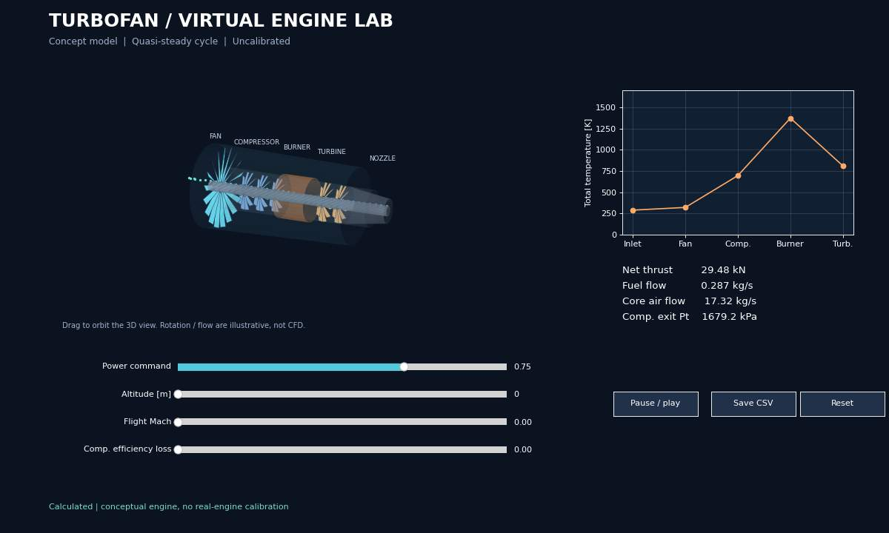

# 브라우저 엔진 실험실 · v0.2

별도 Python 창이 열리지 않아도 **브라우저에서 직접 3D 엔진을 조작**할 수 있습니다.

## 가장 쉬운 실행

- [비공개 실험실 접속](https://digital-twin-engine-woojun.aa01066365388.chatgpt.site) — 사이트 소유자 계정으로 로그인합니다.
- 또는 최신 저장소를 ZIP으로 다운로드하고 압축을 푼 뒤 **`open-web.cmd`를 더블클릭**하세요.
- `web/index.html`을 Edge 또는 Chrome으로 직접 열어도 됩니다. Python, Node, 웹 서버, 외부 CDN 없이 작동합니다.
- 기존 Git 복제본은 로컬 변경을 먼저 보관한 뒤 최신 변경을 가져오세요. ZIP으로 받은 폴더에는 새 ZIP을 별도 폴더에 풀면 됩니다.

## 직접 조작

1. 엔진을 드래그하면 3D 시점이 바뀌며 휠로 확대/축소합니다. 방향키와 +/- 키도 지원합니다.
2. 측면·정면·시점 초기화 버튼으로 시점을 바꿉니다.
3. 내부 보기, 흐름 표시, 회전 일시정지를 조절합니다.
4. 운전 수준·고도·마하수·효율 손실을 조절하거나 지상/순항/효율 저하 예시를 선택합니다.
5. 정상 상태와 현재 상태를 같은 운전 조건에서 비교합니다.
6. **현재 결과 CSV 저장**을 누르면 입력과 계산 결과가 다운로드됩니다.

현재는 모니터에서 조작하는 3D 환경이며 VR 헤드셋 지원은 포함하지 않습니다. 정상상태 모델을 즉시 다시 계산하며, 회전·흐름은 설명용입니다. CFD, 시간에 따른 축 과도응답, 실측 센서 연동은 후속 개발입니다.

## 웹 코드와 검증

- `web/model.js`: 기존 `engine.py`와 같은 수식
- `web/viewer.js`: 외부 라이브러리 없이 투영하는 3D 형상과 마우스 제어
- `web/app.js`: 조건 조절, 그래프, 비교, CSV 내보내기
- `node tests/web-smoke.cjs`: Node가 설치된 환경에서 실행하는 동작 검사

81개 조건에서 Python과 JavaScript의 추력·연료 유량·전온도가 수치 허용오차 이내로 일치함을 확인했습니다. 모의 DOM으로 조절·초기화·저장·시점 코드를 검사했습니다. 이번 클라우드 환경에는 브라우저 제어 도구가 없어 실제 브라우저 화면 렌더링은 검증하지 못했습니다.

아래는 기존 Python 데스크톱 버전 안내입니다.

---

# Digital-Twin · 항공기 엔진 가상 실험실

터보팬 엔진을 가상 공간에 구현하고, 운전 조건·열화·센서 데이터를 연결하는 학습 프로젝트입니다.
현재 **v0.1: 조작 가능한 3D 개념 엔진 + 정상상태 열역학 계산**을 제공합니다.



## 지금 가능한 것

- 팬·압축기·연소기·터빈·노즐의 3D 개념 형상, 회전 애니메이션, 마우스 시점 회전
- 운전 명령, 고도, 비행 마하수, 압축기 효율 손실 조절
- 엔진 각 지점의 전온도·전압력, 추력, 연료 유량 계산
- 조절한 조건과 계산 결과 CSV 저장
- 정상/효율 저하 상태의 34개 운전점 일괄 비교

현재 모델은 실제 엔진에 보정되지 않은 교육용 정상상태 모델입니다. 화면의 회전과 입자는 설명용이며 RPM이나 CFD 결과가 아닙니다. 형상의 치수는 성능 계산에 사용하지 않습니다. 센서 동기화와 수명 예측은 아직 구현 전입니다.

## 처음 실행하기

Python 3.10 이상이 필요합니다. GitHub에서 이 코드가 있는 브랜치를 열고 **Code → Download ZIP**으로 내려받아 압축을 푸세요. 그 폴더에서 터미널을 엽니다.

Windows:

```powershell
py -m venv .venv
.venv\Scripts\python.exe -m pip install -r requirements.txt
.venv\Scripts\python.exe simulator.py
```

macOS / Linux:

```bash
python3 -m venv .venv
.venv/bin/python -m pip install -r requirements.txt
.venv/bin/python simulator.py
```

이 명령은 별도의 데스크톱 창을 엽니다. Python에 Tk 또는 Qt GUI 지원이 필요합니다. Linux에서 Tk가 없다면 배포판의 `python3-tk` 패키지를 설치하세요. GUI가 없는 서버에서는 아래 배치/이미지 모드를 사용할 수 있습니다.

> Python 가상환경 `.venv`는 라이브러리를 분리하는 폴더입니다. 엔진이 표시되는 **3D 가상 공간**과는 다른 개념입니다.

## 화면 사용법

| 화면 용어 | 의미 |
|---|---|
| Power command | 가정한 운전 수준 0.2–1.0. 실제 조종석 스로틀 보정값이 아닙니다. |
| Altitude | 고도 0–11,000 m |
| Flight Mach | 음속 대비 비행 속도 0–0.85 |
| Comp. efficiency loss | 기준 압축기 효율 대비 상대 손실 0–15% |
| Net thrust | 코어·바이패스 합산 순추력 |
| Comp. exit Pt | 압축기 출구 전압력 |
| Pause / play | 설명용 회전 애니메이션 정지·재생 |
| Save CSV | 지금까지 조절한 운전점들을 `results/`에 저장 |

첫 실험: 기본 조건에서 효율 손실을 0 → 0.10으로 바꾸세요. 압축기 출구 온도 증가와 추력 변화를 살펴보고 CSV를 저장합니다. 현재 제어 방식은 연소기 출구 온도를 유지하므로, 효율 저하가 모든 조건에서 연료 증가로 표현되지는 않습니다.

## 창 없이 실행하기

아래 `python`은 위에서 만든 가상환경의 Python으로 실행합니다.

```bash
python simulator.py --batch
python simulator.py --snapshot results/engine.png
python -m unittest discover -s tests -v
```

배치는 해수면·정지 상태에서 정상과 효율 10% 저하 상태를 각각 17개 운전점으로 계산합니다. CSV 행은 독립된 평형 상태이며 시간에 따른 과도응답이 아닙니다.

## 코드를 읽는 순서

1. `engine.py`: 입력 → 대기 → 팬 → 압축기 → 연소기 → 터빈 → 노즐 → 추력
2. `simulator.py`: 계산 결과를 3D 화면과 그래프로 표현
3. `tests/test_engine.py`: 물리적 관계와 계산 범위 확인
4. [모델의 식·가정](docs/model.md), [조사 근거](docs/research.md), [개발 계획](docs/roadmap.md)

의존성: NumPy, Matplotlib. 별도 계정·유료 해석 도구 없이 로컬에서 실행합니다.
